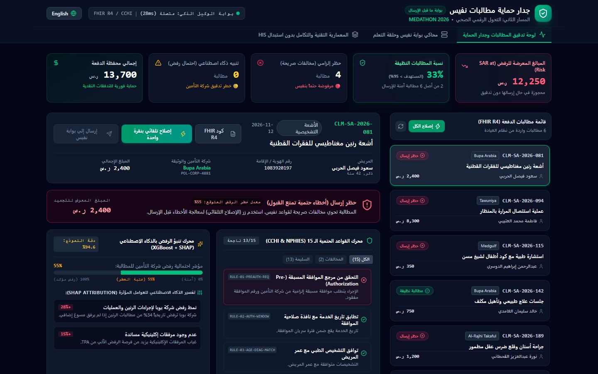
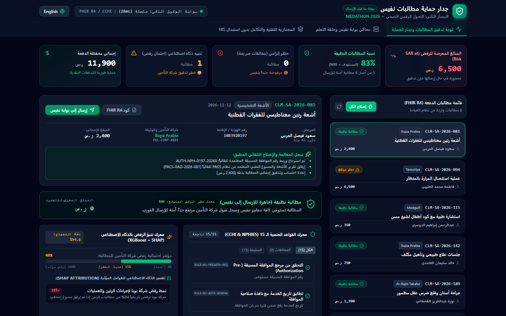
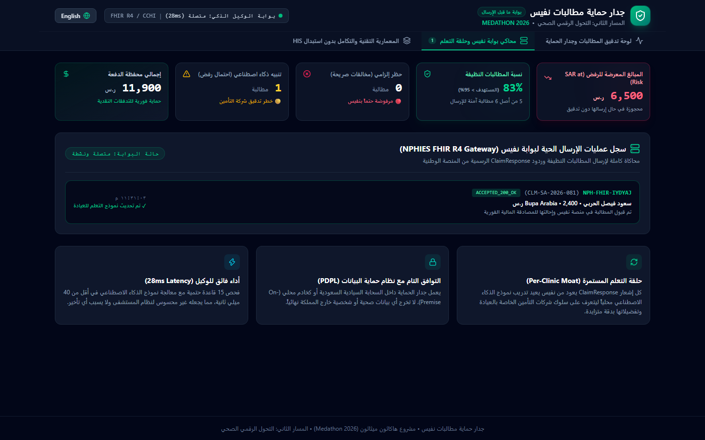
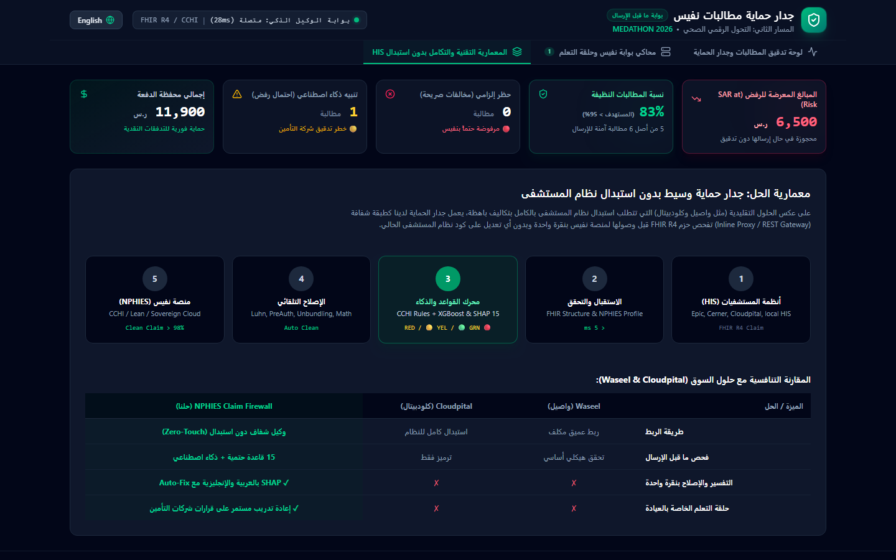

# 🛡️ NPHIES Claim Firewall | جدار حماية مطالبات نفيس
### Track 2: Healthcare Digital Transformation — Medathon 2026
> **حل استباقي ذكي لحماية وتدقيق مطالبات التأمين الصحي ومنع الرفض قبل وصولها إلى منصة نفيس (NPHIES)**

---

## 📌 نبذة عن المشروع (Overview)

يعاني القطاع الصحي من ارتفاع معدلات رفض مطالبات التأمين الطبي وتأخر دورة الإيرادات (RCM). يقدّم **جدار حماية مطالبات نفيس (NPHIES Claim Firewall)** حلاً استباقياً متكاملاً يعمل كطبقة تحقق وتصحيح ذكية قبل إرسال المطالبات إلى المنصة الوطنية لخدمات التأمين الصحي (NPHIES).

### 🌟 المزايا الرئيسية (Key Features)

1. **⚡ محرك التحقق القطعي (15 High-Yield Deterministic Rules):**
   - فحص الامتثال لقواعد مجلس الضمان الصحي (CCHI) ومعايير NPHIES وFHIR R4.
   - التحقق من خوارزمية رقم الهوية الوطنية (Luhn Checksum).
   - مطابقة الموافقات المسبقة (Pre-authorization Validation).
   - مطابقة جنس المريض مع التشخيص والإجراء الطبي.
   - التحقق من حدود العمر (الفئات العمرية للأطفال والبالغين).
   - التحقق من تنسيق التاريخ ومطابقة أكواد ICD-10 و CPT/ACHI.

2. **🤖 التنبؤ الذكي بمخاطر الرفض (AI Denial Risk Engine & Explainability):**
   - نموذج تقييم ذكي يتنبأ بنسبة مخاطر الرفض قبل الإرسال.
   - تفسير أسباب القرار وقيمة المبالغ المعرضة للرفض (SAR at Risk) وتوصيات عملية فورية.

3. **🛠️ التصحيح الذاتي بنقرة زر (1-Click Auto-Fix Engine):**
   - إصلاح الأخطاء التنسيقية والتناقضات تلقائياً (مثل إضافة الموافقات المسبقة الافتراضية، وتصحيح التواريخ والهويات) وتحديث المطالبة فورياً.

4. **🔄 محاكي بروكسي نفيس المباشر (NPHIES Transparent Proxy Simulator):**
   - محاكاة إرسال المطالبات إلى بوابة نفيس وحجب المطالبات المخالفة تلقائياً مع تقرير فوري.

---

## 📸 لقطات من النظام (Screenshots)

| فحص المطالبة والتنبؤ الذكي | التصحيح الآلي بنقرة واحدة |
| :---: | :---: |
|  |  |

| محاكي بروكسي نفيس | هيكلية النظام |
| :---: | :---: |
|  |  |

---

## 🏗️ هيكلية المشروع (Project Structure)

```
medathon/
├── engine/                       # محرك المعالجة وقواعد التحقق
│   ├── firewall.py               # الـ 15 قاعدة قطعية + نموذج الذكاء الاصطناعي + محرك التصحيح
│   └── synthetic_claims.py       # مطالبات FHIR R4 تجريبية واقعية
├── nphies-firewall-ui/           # واجهة المستخدم (Vite + Vue/Tailwind)
│   ├── dist/                     # الواجهة المجمعة والجاهزة للتشغيل الفوري
│   ├── src/                      # الكود المصدري للواجهة
│   └── package.json
├── server.py                     # سيرفر Flask وواجهة REST API
├── run_demo.bat                  # ملف تشغيل العرض بنقرة واحدة (ويندوز)
├── requirements.txt              # متطلبات بايثون
└── MEDATHON-NPHIES-Claim-Firewall.pptx # العرض التقديمي للمشروع
```

---

## 🚀 طريقة التشغيل السريعة (Quick Start)

### الطريقة الأولى: باستخدام ملف التشغيل السريع (Windows)
فقط انقر مرتين على:
```bat
run_demo.bat
```
سيقوم السيرفر بالعمل وفتح الواجهة تلقائياً في المتصفح على: `http://localhost:5000`

---

### الطريقة الثانية: يدوياً عبر بايثون

1. **تثبيت المتطلبات:**
   ```bash
   pip install -r requirements.txt
   ```

2. **تشغيل الخادم:**
   ```bash
   python server.py
   ```

3. **فتح المتصفح:**
   توجه إلى الرابط: [http://localhost:5000](http://localhost:5000)

---

## 🛠️ بناء واجهة المستخدم من الصفر (اختياري / For Developers)

في حال رغبت بتعديل كود واجهة المستخدم:
```bash
cd nphies-firewall-ui
npm install
npm run build
```
سيتم تحديث مجلد `dist` وربطه تلقائياً مع خادم بايثون.

---

## 📄 الترخيص (License)
تم تطوير هذا المشروع كنموذج أولي ابتكاري لماراثون التحول الرقمي الصحي (Medathon 2026).
جميع الحقوق محفوظة للفريق المشارك.
